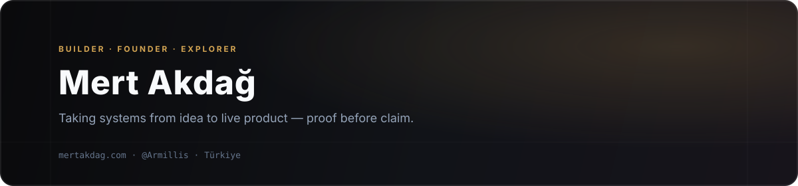

  

I’m **Mert Akdağ** — a founder and software engineer based in Türkiye, taking systems from raw idea to live product. I lead [**Armillis**](https://armillis.com) ([@Armillis](https://github.com/Armillis)), a creative technology and product engineering studio, guided by one principle: [*proof before claim*](https://mertakdag.com/en/philosophy/proof-before-claim/).

---

### Shipped Products & Ventures

| Product | Status | What It Does |
| --- | --- | --- |
| [**EKLER**](https://ekler.app) | Production | Live university & campus ecosystem running across 6 end-to-end modules: Radar, Notes, Podium, Events, Campus Passport, and Savings Wallet. ([Overview →](https://mertakdag.com/en/products/ekler/)) |
| [**Armillis**](https://armillis.com) | Studio & SaaS | Creative technology studio building vertical SaaS (POS & operational workflows), real-time AI/voice systems, and high-craft web platforms. ([@Armillis →](https://github.com/Armillis)) |
| [**WallDiary**](https://mertakdag.com/en/products/walldiary/) | MVP Complete | AI-powered personal journal and memory space designed to organize thoughts, reflections, and daily context. |

---

### Open Source & R&D

- [**armillis-tts**](https://github.com/MertAkdag/armillis-tts) — Tiny, fast, offline Turkish text-to-speech (`8.6M` parameters · `0.92%` WER on Freya-TR-Eval · `~4 ms` first-audio latency · `1,300×` real-time batched throughput on a single GPU).
- [**@mertakdag/react-native-story-viewer**](https://github.com/MertAkdag/react-native-story-viewer) · [`npm v1.1.0`](https://www.npmjs.com/package/@mertakdag/react-native-story-viewer) — 60fps Instagram & Snapchat-style story ring tray and full-screen image/video viewer for React Native & Expo, featuring Reanimated gestures and a headless hook API.

---

### Engineering Focus

- **Web & Systems:** TypeScript, React, Next.js, Vite, Tailwind CSS, Node.js, SQLite, PostgreSQL
- **Mobile & Interactive 3D:** React Native, Expo, Reanimated, Flutter, Three.js / WebGL, Unity (C#)
- **AI & Voice:** PyTorch, Low-Latency Speech Synthesis (TTS), Streaming Audio Inference, Applied LLM Systems

---

### Connect

- **Website & Writing:** [mertakdag.com](https://mertakdag.com) ([English](https://mertakdag.com/en/))
- **Studio:** [armillis.com](https://armillis.com)
- **LinkedIn:** [linkedin.com/in/mertakdag](https://www.linkedin.com/in/mertakdag/)
- **Email:** [mert@mertakdag.com](mailto:mert@mertakdag.com)
